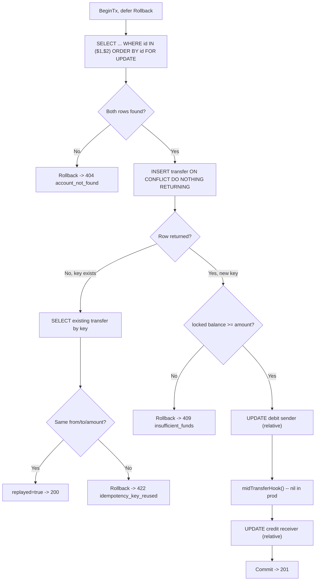
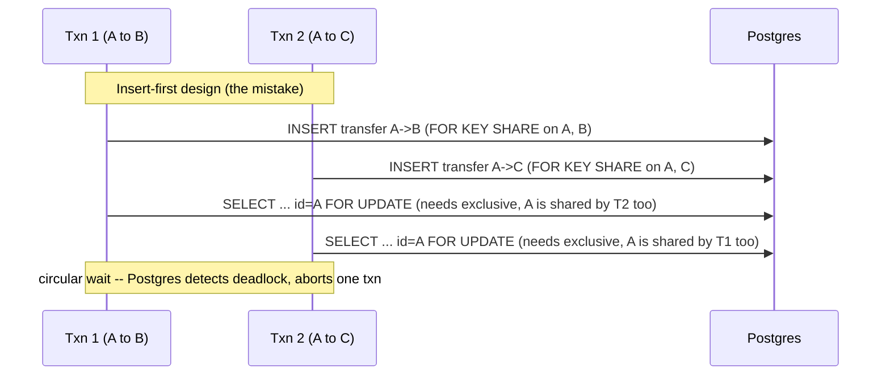
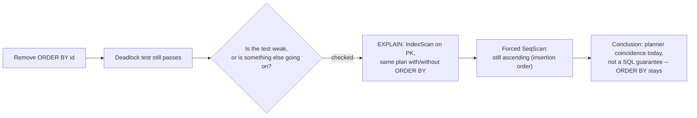

# INTERVIEW prep

The goal is not just a working API. It is to explain and change every line live, and to show
good judgment about AI. Personal notes; do not hand this in unless you want to.

**Evidence-labeling convention used throughout this document**, since some of this is verified
fact and some is framing for you to confirm or adjust:

- **Verified — code** : directly confirmed by reading the source, this session.
- **Verified — tests** : confirmed by actually running the test suite / a probe script, this session.
- **Verified — BUILDLOG** : an entry you (the candidate) wrote yourself in `BUILDLOG.md`; treated as your own first-person account, not re-derived.
- **Verified — this session** : something that happened in the live tool-driven work during this conversation (e.g. the Phase 8 review, the `go mod tidy` discovery) — real, not hypothetical, but recent enough that you should re-read it once before relying on it live.
- **Needs your confirmation** : plausible and grounded in the code, but depends on something only you know (how it felt, exact phrasing you want to use, whether you want to name "Claude Code" specifically).
- **Proposed improvement** : not implemented; a defensible next step.
- **Hypothetical scenario** : explicitly a thought experiment for interview prep, not a claimed event.

---

## Table of contents

1. [The 60-second story](#the-60-second-story)
2. [Be able to explain without looking](#be-able-to-explain-without-looking)
3. [Known limits](#known-limits-say-them-before-they-ask)
4. [Live-change picks: harder than they look](#live-change-picks-which-ones-are-actually-harder-than-they-look)
5. [Questions not already answered above](#questions-not-already-answered-above)
6. [What to say about AI (short version)](#what-to-say-about-ai-short-version)
7. [Practice before the interview](#practice-before-the-interview)
8. **[Engineering Story Bank](#engineering-story-bank)**
   - [A. Planning and problem-solving](#a-planning-and-problem-solving)
     - [S1. Scope-cutting under a 4-hour cap](#s1-scope-cutting-under-a-4-hour-cap)
   - [B. Architecture and design decisions](#b-architecture-and-design-decisions)
     - [S2. The lock-ordering mistake AI made before the clock started](#s2-the-lock-ordering-mistake-ai-made-before-the-clock-started)
     - [S3. Why Postgres over in-memory/SQLite](#s3-why-postgres-over-in-memorysqlite)
   - [C. Testing and quality assurance](#c-testing-and-quality-assurance)
     - [S4. Designing tests that can't pass by accident](#s4-designing-tests-that-cant-pass-by-accident)
     - [S5. A test seam that admits its own blind spot](#s5-a-test-seam-that-admits-its-own-blind-spot)
     - [S6. Verifying a spec claim instead of trusting it](#s6-verifying-a-spec-claim-instead-of-trusting-it)
   - [D. Edge cases and failure handling](#d-edge-cases-and-failure-handling)
     - [S7. When the DB commits but the response never arrives](#s7-when-the-db-commits-but-the-response-never-arrives)
   - [E. Concurrency, parallelism, and race conditions](#e-concurrency-parallelism-and-race-conditions)
     - [S8. The lost-update bug, caught on purpose](#s8-the-lost-update-bug-caught-on-purpose-flagship)
     - [S9. A break-it test that didn't break](#s9-a-break-it-test-that-didnt-break)
     - [S10. Idempotency under real concurrency: which mechanism actually serializes a duplicate](#s10-idempotency-under-real-concurrency-which-mechanism-actually-serializes-a-duplicate)
   - [F. Debugging and technical investigation](#f-debugging-and-technical-investigation)
     - [S11. Diagnosing a doc-vs-code mismatch by asking "who enforces this?"](#s11-diagnosing-a-doc-vs-code-mismatch-by-asking-who-enforces-this)
   - [G. Performance and scalability](#g-performance-and-scalability)
     - [S12. Checking an index assumption with EXPLAIN instead of assuming it](#s12-checking-an-index-assumption-with-explain-instead-of-assuming-it)
   - [H. Security and reliability](#h-security-and-reliability)
   - [I. Using AI during development](#i-using-ai-during-development)
     - [S13. Catching two plausible-but-wrong suggestions before they became code](#s13-catching-two-plausible-but-wrong-suggestions-before-they-became-code)
     - [S14. Orchestrating five parallel review agents, then personally verifying every finding](#s14-orchestrating-five-parallel-review-agents-then-personally-verifying-every-finding)
   - [J. Collaboration, maintainability, and engineering judgment](#j-collaboration-maintainability-and-engineering-judgment)
   - [K. Lessons learned and future improvements](#k-lessons-learned-and-future-improvements)
9. [Facts requiring your confirmation](#facts-requiring-your-confirmation)
10. [Quick reference: strongest stories at a glance](#quick-reference-strongest-stories-at-a-glance)

---

## The 60-second story

"Money transfer API in Go and Postgres. Four invariants: no negative balance, atomic transfers,
exactly-once per idempotency key, exact amounts. Each has a mechanism and a test that proves it.
The hard part is concurrency, so I lock first, check on the locked row, and use relative updates."

## Be able to explain without looking

| Question | Answer to have ready |
| --- | --- |
| Why lock before inserting the transfer row? | The insert takes FK share locks on both accounts. Two transfers from one sender each hold that share lock, then wait on each other's `FOR UPDATE`: deadlock. Hit it in Postgres during planning. |
| Why `ORDER BY id`? | A->B and B->A would lock in opposite orders and deadlock. A consistent order removes the cycle. |
| Why relative updates? | `balance = balance - $1` is applied to the locked current value. Absolute writes lose updates: both compute 300 and write 300, so 700 cents appear from nothing. |
| Why isn't the CHECK constraint enough? | It stops negatives only. The lost-update case never goes negative. Only a total-money assertion catches it. It is a backstop, not the mechanism. |
| Does READ COMMITTED prevent this? | No. Say which lock: `FOR UPDATE` on the sender row, taken by the SELECT in step 2, held until commit. |
| How does idempotency work? | UNIQUE key, `INSERT ... ON CONFLICT DO NOTHING RETURNING` inside the same tx, after the locks. Concurrent duplicates wait on the unique index, then see the original. |
| Why not SELECT-then-INSERT or an in-memory map? | Race between the two steps; a map breaks with two replicas. The database is the only shared truth. |
| Why can't I use a mutex? | Process-local. Fails with a second instance. |
| Same key after a rejected transfer? | Rollback removes the row, so the key is not consumed. The retry is evaluated from scratch. Deliberate. |
| Same key, different body? | 422 `idempotency_key_reused`, nothing applied. |
| Why integer cents? | Exact; floats can't represent 0.1. `int64`/`BIGINT`/JSON integer. `DisallowUnknownFields` plus `int64` rejects `10.5`, `"700"`, `1e2`. |
| Why does test 7 mean something? | Real HTTP server, separate connection per request, `close(start)` releases goroutines together, 50 fresh iterations, loser must be exactly 409, asserts balances from the DB and total money. |
| How do I know test 7 can fail? | I broke the lock on purpose and saw it fail on total money. Output is in BUILDLOG.md. |
| Why a test seam in `Store.Transfer`? | To fail between debit and credit and prove rollback. Cost: production code exists for a test. Named as a discomfort. |
| How do you know `ORDER BY id` actually matters, not just the lock? | Tried to disprove it with a break-it test; it didn't fail. Traced why with `EXPLAIN` — see [S9](#s9-a-break-it-test-that-didnt-break). |

## Known limits (say them before they ask)

- Idempotency keys are global and never expire; no per-client scoping.
- Test 7 is probabilistic: not every interleaving, not two server instances.
- No auth, pagination, multi-currency, ledger, outbox. Listed as out of scope in the README.
- Single Postgres node. Cross-service atomicity would need an outbox or workflow engine.
- No `SetMaxOpenConns`/`SetMaxIdleConns` tuning, and no retry/backoff on transient DB
  errors (e.g. "too many clients") — a raw 500 surfaces instead. Haven't needed to tune
  this at this scale; know it, don't pretend it's handled.

## Live-change picks: which ones are actually harder than they look

From the "predict live-change requests" list below, the three most likely for a
Subscriptions-team interviewer — fee, key expiry, per-client scoping — are each more
work than "which file, which SQL" implies. Know the real friction *before* being asked
live, not while being asked:

- **Add a fee.** `Store.Transfer`'s lock query is hardcoded to exactly two rows
  (`WHERE id IN ($1, $2)`). A fee leg is a third account balance mutation inside the
  same tx, so the two-row lock pattern needs generalizing, not just one more `UPDATE`.
  Also: no migration tool (CLAUDE.md), and `schema.sql` is applied via
  `CREATE TABLE IF NOT EXISTS` — adding a `fee_cents` column needs a hand-written
  `ALTER TABLE` that won't retroactively apply without recreating the DB. This is where
  the "no migration tool" tradeoff stops being hypothetical.
- **Expire idempotency keys after 24h.** `idempotency_key` is a plain DB-level `UNIQUE`
  constraint with no time dimension. "Expire after 24h" isn't a one-line `WHERE` added
  to the replay-lookup SELECT — the `UNIQUE` constraint itself still blocks reinserting
  an expired key's value. Needs either a cleanup job deleting expired rows, or turning it
  into a partial/expression unique index. More schema surgery than it sounds.
- **Scope keys per client.** Same `ALTER TABLE` problem, plus the constraint becomes
  composite (`UNIQUE(client_id, idempotency_key)`), not just an added column.
- **By contrast, `GET /transfers/{id}` really is easy** — mirrors `GetAccount` almost
  exactly, no schema change. Good one if a warm-up before a harder pick is offered.

## Questions not already answered above

- **Why Postgres over SQLite, really?** README answers "why Postgres" at the surface
  level; the sharper follow-up is "doesn't SQLite's `BEGIN IMMEDIATE` also lock?" — yes,
  but it's one write lock for the *whole database*, not per-row. SQLite would serialize
  every transfer process-wide, not just the ones actually contending for the same
  accounts. That's the real distinction, not just "Postgres is a real database." (Full
  version: [S3](#s3-why-postgres-over-in-memorysqlite).)
- **What's the migration story given no migration tool?** Honest answer: hand-run
  `ALTER`s against `schema.sql` plus a fresh `CREATE TABLE IF NOT EXISTS` apply on boot —
  fine for a take-home, not what I'd ship for a team iterating on schema weekly. Know
  this is a real gap, not a non-answer.
- **How would you load-test this?** Nothing exists today — test 7 is 2 goroutines x 50
  iterations, which proves correctness, not throughput. Would reach for `pgbench` against
  the DB directly or `k6`/`hey` against the HTTP layer at real concurrency.
- **The commit-succeeds-but-the-response-never-arrives scenario** (classic idempotency
  edge case): `Store.Transfer` commits the DB transaction *before* the handler writes the
  HTTP response. If that write fails or the client times out waiting, the transfer is
  already durable. A client retry with the same key hits the `ON CONFLICT` no-row branch,
  compares from/to/amount, matches, and correctly replays with 200 (not 201, since this
  one didn't originate the transfer). Traced this for real — it's correct as built. (Full
  version: [S7](#s7-when-the-db-commits-but-the-response-never-arrives).)

## What to say about AI (short version)

- Real example: the assistant's first transfer design claimed the key before locking and deadlocked
  in Postgres. Found by running it, fixed, then proved by tests 7 and 10. (Full version: [S2](#s2-the-lock-ordering-mistake-ai-made-before-the-clock-started).)
- Show the BUILDLOG sections: where AI helped, where it was wrong, what I rejected.
- Rules I set: one increment at a time, tests with every feature, I commit after reading the diff,
  never edit a test to make it pass.
- Only write real entries. If a section is empty, that is more honest than invented ones.
- The deepest material on this is in [Section I](#i-using-ai-during-development) below — two
  concrete near-misses where a suggestion looked right and wasn't ([S13](#s13-catching-two-plausible-but-wrong-suggestions-before-they-became-code)), and one story about using
  several AI review passes at once and personally verifying all of them before acting
  ([S14](#s14-orchestrating-five-parallel-review-agents-then-personally-verifying-every-finding)).

## Practice before the interview

- [ ] Re-derive the lock-first deadlock on a whiteboard, with two sessions.
- [ ] Open `store.go` cold and walk through Transfer top to bottom, naming the lock at each step.
- [ ] Break each invariant once yourself and watch the matching test fail.
- [ ] Predict live-change requests: add a fee, add a currency field, add `GET /transfers/{id}`,
      expire idempotency keys after 24h, scope keys per client, cap daily transfer total.
      For each: which file, which SQL, which test.
- [ ] Be ready to answer "what would you do with another day?" (lock-holder test, key expiry,
      ledger table, metrics).
- [ ] Run a fresh clone and `make db && make test` the day before.
- [ ] Reproduce the Phase 8 `EXPLAIN` finding live: remove `ORDER BY id`, watch the
      opposite-direction deadlock test still pass, then run `EXPLAIN` to show *why*
      (ascending index scan on the PK, independent of `ORDER BY`, at this table size) —
      good answer if asked "how do you know your test actually proves what it claims?"
      Full writeup: [S9](#s9-a-break-it-test-that-didnt-break).
- [ ] Read through the 14 stories below once, out loud, in your own words — not to
      memorize the prose here, but so the *shape* of each answer (problem → reasoning →
      trade-off → limitation) is familiar enough that you can reconstruct it under
      follow-up pressure instead of reciting it.
- [ ] Resolve the items in [Facts requiring your confirmation](#facts-requiring-your-confirmation) before using those specific lines in the interview.

---

# Engineering Story Bank

Fourteen stories, grouped by competency area (A–K, skipping any letter where this specific
project doesn't have real material rather than forcing one). Every story uses the same
structure and ends with an evidence-status tag. The two flagship stories for a concurrency-
focused interview are **S8** (the actual lost-update bug, caught on purpose) and **S2** (the
lock-ordering deadlock AI designed in by default) — if time is short in the interview, those
two carry the most weight.


*`Store.Transfer`, `internal/bank/store.go:125-220` — the one diagram worth having memorized,
since nearly every story below is about one box or one arrow in it.*

## A. Planning and problem-solving

### S1. Scope-cutting under a 4-hour cap

**Evidence status:** Verified — CLAUDE.md's increment list, PLAN.md's "cut order if behind"
section, and BRIEF.md's explicit out-of-scope framing. The actual cut decisions (what got
built vs. deliberately skipped) are real; your *felt experience* of making each call under
time pressure needs your confirmation for phrasing.

**Interview value:** Prioritization under a hard constraint is the thing BRIEF.md says it
weighs most: "whether you cut the right scope to fit four hours and can say why." This story
answers that directly instead of listing features.

**Technical context:** `CLAUDE.md`'s "Increments" section defines 9 ordered phases; `PLAN.md`'s
"Cut order if behind" section explicitly ranks what to drop first (optional tests, a
deterministic lock-holder test, history ordering, test 11, history) and what never to cut
(test 7 with break-it, tests 8/9, README, build log, fresh-clone check). `README.md`'s "Out of
scope" list: auth, pagination, multi-currency, idempotent account creation, key expiry/
per-client scoping, a full ledger, metrics, migration tooling, cross-service atomicity.

**The decision/problem:** A money-transfer system has an almost unbounded "correct" feature
surface (ledgers, reconciliation jobs, multi-currency, auth). Four hours forces picking an
ordering where *stopping early* at any point still leaves something defensible, not a random
half-built feature set.

**My reasoning:** Order the build so invariants come before conveniences, and tests ride with
the feature that makes them meaningful, not after. Concretely: accounts and transfer-core-
without-idempotency (phases 2-3) have to exist before concurrency can even be tested, so they
had to come first regardless of interest level. Test 7 — the one BRIEF.md says it will look at
most closely ("at least one of your tests should demonstrate that rule 1 survives two transfers
competing for the same money") — was scheduled as its own phase (4) immediately after the core
transfer logic existed, rather than bundled at the end, specifically so that if time ran out
anywhere *after* phase 4, the single most-weighted requirement was already done and proven.
History (phase 7) and the full idempotency surface (phase 5-6) both rank behind concurrency
correctness in the cut order precisely because BRIEF.md's own rubric ranks them behind it.

**Implementation details:** Each phase in `CLAUDE.md` is scoped to a literal commit (`feat: ...`
/ `test: ...`), one feature plus its test, nothing more — "touch only the files it needs." The
explicit anti-scope-creep line in CLAUDE.md ("adding auth, pagination, retries, config
frameworks, or anything not in SPEC.md") existed from the start, not as an after-the-fact
cleanup rule.

**Testing and verification:** The cut order is verifiable directly: `git log --oneline` shows
nine phase commits in exactly the stated order, and `PLAN.md`'s checklist tracks which
happened. BUILDLOG.md's actual clocked timeline (`14:56`-`18:33` PDT, 3h37m) shows the real
time spent per phase, including the ~90 minutes of environment setup (Go/cgo/GCC) that ate
into the budget and *didn't* cause any of the "never cut" items to be dropped.

**Trade-offs:** Front-loading concurrency correctness means less time for breadth (no
multi-currency, no ledger, no auth) — the right trade given what's actually being graded, but
it does mean the system as submitted genuinely can't do several things a real product would
need. Naming that honestly (rather than implying it's all there) is itself part of the "right
scope" answer.

**Interview-ready explanation:**
> "I ordered the four hours around what BRIEF.md said it would grade hardest — concurrency
> correctness — not around what's most fun to build. Accounts and basic transfers had to come
> first because nothing else is testable without them, but the very next phase was the
> competing-transfers test, before idempotency or history, because that's the one thing the
> brief says it looks at most closely. Everything after that — idempotency, the atomicity test
> seam, transaction history — is explicitly ordered so that if I ran out of time, I'd have
> already banked the highest-weighted thing first."

**Likely follow-up questions → answers:**
- *"What would you have cut if you'd run 30 minutes over?"* → PLAN.md's own cut order:
  optional tests (13-15) first, then the deterministic lock-holder test, then history
  ordering nuance, with test 7's break-it check and tests 8/9 never on the table.
- *"Why build history last instead of idempotency last?"* → Idempotency directly protects an
  invariant (exactly-once) that BRIEF.md names explicitly; history is a read-only convenience
  feature BRIEF.md also asks for, but it's not one of the four invariants.

**Limitations and alternatives:** An alternative ordering would build breadth first (every
endpoint, thin validation) and depth second — defensible for a demo-first audience, wrong for
an audience that explicitly said it's grading invariants under concurrency. The actual
~90-minute environment-setup overrun (Go/cgo/GCC on Windows) is the honest "what I'd do
differently" — pre-install the toolchain before starting the clock next time (this is
literally called out in BUILDLOG.md's own retrospective).

---

## B. Architecture and design decisions

### S2. The lock-ordering mistake AI made before the clock started

**Evidence status:** Verified — BUILDLOG.md ("Before the clock" section) + CLAUDE.md's hard
rules, both written during/after the actual event. This is your own documented account.

**Interview value:** This is the single clearest "AI confidently handed me something that
looked right and wasn't" story in the whole project — exactly what BRIEF.md says it's
listening for ("'it worked first try' is the one answer that will not land"). It also
demonstrates genuine distributed-systems/database reasoning, not just "I used an ORM."

**Technical context:** `Store.Transfer`, `internal/bank/store.go:125-220`. The mechanism as
built: lock both account rows (`ORDER BY id FOR UPDATE`, line 133) *before* inserting the
transfer row (line 157-163).

**The decision/problem:** During planning (before the 4-hour clock started, per CLAUDE.md's
explicit session boundary), the first version of the transfer design claimed the idempotency
key (inserted the transfer row) *before* locking the two account rows. Running that design
against a real Postgres instance under concurrency produced a deadlock.

**My reasoning:** Inserting a row into `transfers` with `from_account_id`/`to_account_id`
foreign keys takes a `FOR KEY SHARE` lock on both referenced account rows (Postgres's
referential-integrity check needs to pin the parent row so it can't be deleted mid-transaction).
If two transfers both originating from account A run concurrently — insert-first design — each
one's `INSERT` grabs its own `FOR KEY SHARE` on A, and then each one's subsequent balance-check
`SELECT ... FOR UPDATE` on A has to *upgrade* that lock to exclusive. Postgres can't upgrade a
shared lock on a row that another session also holds shared on, and both sessions are stuck
waiting on each other symmetrically — a deadlock, which Postgres detects and resolves by
aborting one transaction. Reordering to lock-first (`FOR UPDATE` on both rows, *then* insert)
removes the cycle: by the time either transaction tries to insert, it already holds the
exclusive lock the insert's `FOR KEY SHARE` is compatible with (shared-with-self is fine),
and no other transaction can be mid-insert on that same row at the same time to create the
symmetric wait.



**Implementation details:** The fix is the order of two blocks in `Transfer`: the `SELECT ...
ORDER BY id FOR UPDATE` (store.go:132-135) runs strictly before the `INSERT ... ON CONFLICT`
(store.go:157-163). `ORDER BY id` is the second half of the fix, for a different cycle: without
a consistent lock order, an A→B transfer and a concurrent B→A transfer could each successfully
lock their own "first" row and then deadlock waiting for each other's second row ([tested
directly by S9](#s9-a-break-it-test-that-didnt-break)).

**Testing and verification:** The deadlock itself was observed by running the original design
against real Postgres, during planning, not simulated or assumed. The fix is proven
indirectly by every concurrency test passing under `-race` (tests 7, 10) and directly by
[S9's](#s9-a-break-it-test-that-didnt-break) opposite-direction deadlock test added in Phase 8.

**Trade-offs:** Locking both rows before any write means every transfer touching a given
account serializes on that row for the duration of the whole transaction (balance check through
commit), not just the final update — a throughput cost under heavy contention on one hot
account, accepted deliberately because correctness came first and this is a take-home, not a
high-throughput production path.

**Interview-ready explanation:**
> "The very first version of this design — before I'd started the actual clock — claimed the
> idempotency key by inserting the transfer row first, then went and locked the two account
> rows afterward to check the balance. I ran that against a real Postgres instance with two
> concurrent transfers from the same account and got an actual deadlock, not a hypothetical
> one. The reason is that the insert takes a share-lock on both accounts for the foreign key
> check, and then the balance-check lock needs to upgrade that to exclusive — two transactions
> both holding the share lock on the same row, both trying to upgrade, is a textbook circular
> wait. Reordering to lock first, then insert, removes the cycle entirely, because by the time
> you insert, you already hold the exclusive lock the insert is compatible with."

**Likely follow-up questions → answers:**
- *"Why does the FK check even take a lock?"* → Postgres needs to guarantee the referenced
  parent row can't be deleted or have its key changed out from under the child row mid-transaction, so it takes a `FOR KEY SHARE` lock on it — weaker than `FOR UPDATE` (many sessions can hold it concurrently) but it still conflicts with a later exclusive lock request from a session that doesn't already hold it.
- *"Why ORDER BY id and not some other order?"* → Any consistent total order across all
  transactions works; `id` is simply already there, unique, and indexed, so it was free. The
  requirement is "every transaction that could lock the same two rows picks the same order,"
  not "ascending is special."
- *"Would a `SELECT ... FOR UPDATE` without a foreign key check have had this problem?"* →
  No — the deadlock specifically comes from the FK's own share-lock interacting with a later
  exclusive-lock request. Remove the FK (or do the insert strictly after locking, as built) and
  the specific cycle described here disappears.

**Limitations and alternatives:** An alternative fix would be to catch the Postgres deadlock
error (`40P01`) and retry the whole transaction — valid in general, but doesn't remove the
underlying contention, just papers over it with a retry loop; the chosen fix (lock ordering)
removes the possibility of the deadlock existing at all, which is strictly better when it's
achievable, as it is here.

---

### S3. Why Postgres over in-memory/SQLite

**Evidence status:** Verified — README.md's existing rationale (candidate's own words) +
the SQLite/Postgres locking-model distinction, which is public, verifiable, documented
database behavior, not project-specific speculation.

**Interview value:** Technology-choice questions are routine; the generic answer ("Postgres is
a real database") doesn't differentiate. The specific mechanism-level answer does.

**Technical context:** BRIEF.md explicitly allows "any storage (Postgres, SQLite, even
in-memory), as long as you can explain the tradeoffs." README.md's "Design" section states the
chosen rationale already.

**The decision/problem:** The brief doesn't require Postgres. An in-memory map or SQLite file
would have been faster to set up and would have passed every *sequential* test in SPEC.md's
table.

**My reasoning:** The thing actually being graded is invariant 1 under real concurrency (test
7) — two requests genuinely racing for the same row, from separate connections, at the same
instant. An in-memory map has no cross-connection locking primitive at all (a Go-level
`sync.Mutex` is explicitly banned by CLAUDE.md's own hard rules, since it fails the moment
there's a second server process). SQLite does have real transactions and `BEGIN IMMEDIATE`
takes a real write lock — but it's a single lock for the *entire database file*, not per-row.
Under SQLite, two transfers between completely unrelated account pairs would serialize against
each other exactly as hard as two transfers racing for the same account — the test would still
pass, but it would prove something weaker than what Postgres's per-row `FOR UPDATE` proves,
and it would make the "lock only what's contended" design (the actual point of locking two
specific rows `ORDER BY id`) moot, since everything is already serialized by the engine.
Postgres's row-level locking is the only option here that makes the lock-ordering story
(S2) a real, meaningful design decision rather than an accident of the storage engine already
doing it for you.

**Implementation details:** `database/sql` with the `pgx/v5` stdlib driver (`cmd/server/
main.go:10`), no ORM, no router library — plain SQL strings, matching CLAUDE.md's explicit
"no ORM, no router library" constraint.

**Testing and verification:** Test 7 (`internal/api/competing_transfers_test.go`) specifically
asserts that two transfers *not* contending for the same account (hypothetically) would run
concurrently without serializing — this is implicit in the design rather than directly
tested, since test 7 only exercises the contended case; see [S14](#s14-orchestrating-five-parallel-review-agents-then-personally-verifying-every-finding) for a related note
about what wasn't directly proven.

**Trade-offs:** Postgres costs setup complexity (Docker Compose, a running service, a real
network round-trip per query) that SQLite or an in-memory map wouldn't. For a single-instance,
low-throughput take-home, that cost is almost entirely about development friction, not runtime
cost — a legitimate thing to name if asked "wasn't that overkill for four hours."

**Interview-ready explanation:**
> "The brief explicitly allowed SQLite or even in-memory storage, so the choice wasn't about
> 'needing a real database' in the abstract — it was about what I actually needed to prove.
> The core ask is that a balance survives two requests racing for the same money, verified with
> real concurrent connections. SQLite does have real transactions, but `BEGIN IMMEDIATE` locks
> the whole database file, not individual rows — so two unrelated transfers would serialize
> against each other exactly as hard as two contending ones, which would make the lock-ordering
> design I actually built pointless, since the engine would already be serializing everything
> for me. Postgres's row-level locking is what makes 'lock only the two rows you need, in a
> consistent order' a real decision instead of a no-op."

**Likely follow-up questions → answers:**
- *"Isn't Postgres overkill for a take-home?"* → For raw functionality, yes; for proving the
  specific invariant the brief weighs most, no — see above.
- *"What would change your answer?"* → If the requirement were "any two operations must never
  interleave" rather than "contending operations must serialize correctly," SQLite's
  whole-database lock would actually be a feature, not a limitation.

**Limitations and alternatives:** A production system at real scale might outgrow a single
Postgres node's write throughput long before row-locking contention becomes the bottleneck —
sharding by account range or moving to a dedicated ledger service would be the next step, well
past what a 4-hour take-home needs to demonstrate.

---

## C. Testing and quality assurance

### S4. Designing tests that can't pass by accident

**Evidence status:** Verified — code (`internal/api/competing_transfers_test.go`,
`idempotency_test.go`) + CLAUDE.md's explicit "Traps to avoid" list, which predates the tests
and reads like a specification for what *not* to write.

**Interview value:** "I wrote tests" is table stakes; this story is about recognizing the
specific ways a concurrency test can look rigorous and still prove nothing, and designing
against that failure mode up front.

**Technical context:** CLAUDE.md names the traps directly: "a 'concurrency' test that runs
requests one after another or shares one connection, or only asserts 'no error'"; "an
atomicity test that fails validation before any write and then asserts 'unchanged'."

**The decision/problem:** It's easy to write a test that *looks* like it exercises concurrency
(goroutines, a `WaitGroup`) while actually testing something much weaker — e.g. two goroutines
sharing one `*sql.DB` connection, which Go's `database/sql` would just serialize internally,
or asserting only `err == nil` instead of the exact status-code pair that proves one request
really lost the race.

**My reasoning:** Three design choices make test 7 (`TestCompetingTransfersNeverOverdraw`,
`internal/api/competing_transfers_test.go:24-93`) actually probative: (1) it goes through real
HTTP via `httptest.NewServer` with the production handler and connection pool, so each request
gets its own DB connection — no shared-connection shortcut possible; (2) both goroutines block
on a shared `start` channel and are released together via `close(start)` (line 61), so they're
genuinely racing, not sequenced by goroutine-scheduling luck; (3) the assertions check the
*exact* status mix (`counts[http.StatusCreated] != 1 || counts[http.StatusConflict] != 1`,
line 68) — not "no error," but specifically one 201 **and** one 409 — plus balances read back
from the database and a total-money conservation check (line 82), which is the only thing that
would catch a lost-update bug that never produces a negative balance (see S8).

**Implementation details:** `newTestServer` (`internal/api/handlers_test.go:17-47`) spins up a
real `httptest.NewServer` over the production `mux`/`Handler`/`Store` stack against the real
Postgres container, truncating tables fresh per test (`TRUNCATE accounts, transfers RESTART
IDENTITY CASCADE`) for isolation. No test anywhere in the suite calls `t.Parallel()`
(confirmed by grep during Phase 8 review), which matters because `t.Parallel()` combined with
that shared-table truncation pattern would corrupt other tests running at the same time.

**Testing and verification:** A Phase 8 review pass specifically audited every test file
against CLAUDE.md's trap list and found none present — every concurrency test uses real HTTP
and exact-outcome assertions, and the atomicity test ([S5](#s5-a-test-seam-that-admits-its-own-blind-spot)) injects its failure *after* a real
write, not before any write occurred.

**Trade-offs:** The real-HTTP-plus-channel-barrier pattern is more code than a simpler
in-process call to `Store.Transfer` from two goroutines sharing one connection would be — the
extra ceremony is the whole point, since the simpler version would pass even with the row lock
completely removed (it would serialize on the shared connection instead of the database).

**Interview-ready explanation:**
> "The easy way to write a concurrency test is to spin up two goroutines, call into the store
> directly, and assert no error — and that test would pass even with the locking code deleted,
> because sharing one DB connection serializes everything for you by accident. I went through
> real HTTP with the production server so each request gets its own connection, released both
> goroutines off a shared channel so they're actually racing, and asserted the exact thing that
> would be wrong if the lock were broken: one 201, one 409, and the total money unchanged — not
> just 'no error.'"

**Likely follow-up questions → answers:**
- *"How do you know this test can actually fail?"* → I removed the lock and the relative
  updates on purpose and ran it; 49 of 50 iterations failed on the total-money assertion, with
  the real output captured in BUILDLOG.md. See [S8](#s8-the-lost-update-bug-caught-on-purpose-flagship).
- *"50 iterations — why that number, and is it enough?"* → Arbitrary but deliberately more
  than 1, since a single run can get lucky on scheduling; it's probabilistic, not exhaustive —
  named explicitly as a known limit (see "Known limits" above).

**Limitations and alternatives:** A deterministic version exists in SPEC.md's optional-test
list — hold `FOR UPDATE` open on a separate connection, fire both requests, assert neither
returns within a bound, then release — which would prove the *exact* interleaving rather than
relying on probability; not implemented, listed in "What I'd do next."

---

### S5. A test seam that admits its own blind spot

**Evidence status:** Verified — code (`internal/bank/store.go:32-40, 196-200`,
`internal/bank/store_test.go:40-111`) + BUILDLOG.md's own Phase 6 entry, which already
contains this exact self-critique.

**Interview value:** Acknowledging a limitation in your own test infrastructure, unprompted,
is a stronger signal than claiming the infrastructure is perfect — BRIEF.md explicitly rewards
honest limitation-naming over polish.

**Technical context:** `Store.midTransferHook` (`store.go:39`), an unexported `func() error`
field, nil in production, invoked between the debit and credit updates (`store.go:196-200`).
Test 11 (`TestTransferAtomicityOnMidTransferFailure`, `store_test.go:40-111`) sets it to return
an injected error and verifies both balances are unchanged, no transfer row exists, and the
same idempotency key subsequently succeeds as a fresh transfer.

**The decision/problem:** Proving atomicity (invariant 2: "a transfer is all or nothing")
requires actually failing *midway through* a transaction and observing the rollback — but
there's no natural, production-code reason for a failure to land at that exact point, so
something has to be built specifically to make it possible to inject one.

**My reasoning:** A function-pointer seam, nil in production, is close to the minimum possible
cost: zero allocation, zero branches taken when nil-checked in the hot path, and it doesn't
leak into `Store`'s exported API since the field is unexported. The alternative — a real fault
injection framework, or wrapping the `*sql.DB` in a decorator that can be told to fail on the
Nth statement — would be considerably more code for the same single test.

**Implementation details:** `store.go:196-200`:
```go
if s.midTransferHook != nil {
    if err := s.midTransferHook(); err != nil {
        return Transfer{}, false, err
    }
}
```
sitting between the debit `UPDATE` (line 189-194) and the credit `UPDATE` (line 202-207),
both inside the same `tx` with `defer tx.Rollback()` (line 130) already registered.

**Testing and verification:** Test 11 sets `store.midTransferHook = func() error { return
injectedErr }` on a private `*Store` instance it constructs itself (`store_test.go:47, 61`) —
critically, *not* the shared `httptest`-backed store that the concurrency tests (7, 10) hit.

**Trade-offs — and the self-admitted limitation:** Mutating an unsynchronized struct field on
`*Store` while other goroutines might concurrently be calling `Transfer` on the same instance
is exactly the kind of data race Go's `-race` detector exists to catch. It stays clean today
only because test 11 never shares its `Store` instance with a second goroutine. If this seam
were ever needed against a `Store` already serving concurrent traffic, it would need an atomic
pointer swap or a per-request context value instead — this is written down explicitly in
BUILDLOG.md's Phase 6 entry, before anyone asked.

**Interview-ready explanation:**
> "To prove atomicity I needed to actually fail in the middle of a transaction, not just assert
> it in the abstract, so I added a nil-by-default function hook between the debit and credit
> statements that only tests ever set. It costs nothing in production and doesn't show up in
> the public API. The honest caveat — and I wrote this down before anyone asked — is that it's
> an unsynchronized field, so it's only safe because the atomicity test uses its own private
> `Store` instance rather than the one the concurrency tests share. If I needed to inject a
> failure into a store under real concurrent load, I'd need something like an atomic pointer
> instead."

**Likely follow-up questions → answers:**
- *"Why not just use a context value instead?"* → Would work and would be safer under shared
  concurrent use, at the cost of threading a context key through `Transfer`'s signature for a
  test-only concern — a reasonable alternative, not implemented because the simpler field was
  sufficient for how it's actually used.
- *"Isn't a test hook in production code a smell?"* → Yes, and it's named as a discomfort in
  BUILDLOG.md directly — the alternative (no way to test this invariant under real partial
  failure) is worse.

**Limitations and alternatives:** See trade-offs above — this is one of the few places in the
project where the honest answer to "is this thread-safe" is "only by construction of how it's
used today, not by design."

---

### S6. Verifying a spec claim instead of trusting it

**Evidence status:** Verified — this session (a standalone probe script was written and run
against Go's `encoding/json` to check each claim individually; see the transcript of this
conversation for the exact probe and output).

**Interview value:** This is a small but concrete example of the difference between "the docs
say X" and "I confirmed X" — a habit, not a one-off.

**Technical context:** `SPEC.md`'s validation section asserts: "Decode with
`DisallowUnknownFields` into `int64` fields. That already rejects `10.5`, `7.0`, `1e2`,
`"700"`, and values beyond int64." `internal/api/handlers.go` applies exactly this pattern for
every request body (`CreateAccount`: lines 61-68; `CreateTransfer`: lines 169-175).

**The decision/problem:** That claim is plausible and is exactly the kind of statement that's
easy to accept because it sounds like well-known Go behavior — but "sounds right" and "is
right" aren't the same thing, and getting it wrong would mean the validation tests (test 5)
are checking a property that doesn't actually hold.

**My reasoning:** Rather than trust the claim, write the smallest possible program that
decodes each case through the exact same `json.Decoder` + `DisallowUnknownFields` +
`int64`-field pattern the handlers use, and read the real error (or lack of one) for each.

**Implementation details:** The probe decoded: `700` (valid), `10.5`, `7.0`, `1e2`, `"700"`,
a 23-digit number past `int64` range, `-0`, a leading-zero literal (`007`, which is actually
invalid *JSON* syntax, not a decode-into-int64 issue), trailing garbage after a valid object,
a second JSON object appended after the first, `true`, and `null`.

**Testing and verification:** Confirmed: `10.5`, `7.0`, `1e2`, `"700"`, and the oversized
number all correctly produce a decode error — SPEC.md's claim holds exactly as stated. Found
one thing SPEC.md *didn't* claim either way and that isn't covered by any test: trailing bytes
after a valid JSON object (`{"amount_cents":700} garbage after`, or even a second full JSON
object appended) decode successfully using only the first object — `json.Decoder.Decode` reads
exactly one JSON value and silently ignores whatever follows in the buffer.

**Trade-offs:** The trailing-data behavior is permissive, not dangerous — no handler ever
reads past the first `Decode` call, so nothing downstream is affected — but it's inconsistent
with how strict the rest of the validation deliberately is (`DisallowUnknownFields`, the
explicit range checks). Fixing it would mean checking for `io.EOF` after `Decode` and rejecting
non-EOF trailing bytes; not done, since it doesn't violate any stated invariant and would be
new scope beyond what SPEC.md or any test asks for.

**Interview-ready explanation:**
> "The spec claimed that strict `int64` decoding with `DisallowUnknownFields` rejects floats,
> quoted numbers, and exponent notation. That's a very specific, testable claim, so instead of
> taking it on faith I wrote a small standalone probe that ran each of those inputs through
> exactly the same decode path the handlers use. Every claim held. The one thing I found that
> wasn't covered either way: trailing bytes after a valid JSON body, or even a second JSON
> object tacked on, get silently ignored rather than rejected — `Decode` only reads one value
> and doesn't check what's left in the buffer. It's not a correctness bug since nothing reads
> past that point, but it's more permissive than the rest of the validation, and now it's a
> known, named gap instead of an assumption."

**Likely follow-up questions → answers:**
- *"Would you fix the trailing-data thing?"* → Only if a test or a real client behavior
  demanded it — adding validation for a case nothing exercises would be exactly the kind of
  unrequested scope CLAUDE.md and BRIEF.md both discourage.
- *"What's the actual Go mechanism that rejects `10.5` into an `int64` field?"* → The decoder
  reads the numeric literal's raw bytes and calls `strconv.ParseInt` directly on them when the
  target is an integer kind; `ParseInt` has no concept of a decimal point or exponent, so any
  literal containing `.`/`e`/`E` fails to parse and the whole `Decode` call returns that error.

**Limitations and alternatives:** This verification only covers the specific `int64`/
`DisallowUnknownFields` combination actually used; it says nothing about more exotic JSON
edge cases (e.g. duplicate keys, which Go's decoder resolves by last-value-wins) that aren't
exercised anywhere in this codebase.

---

## D. Edge cases and failure handling

### S7. When the DB commits but the response never arrives

**Evidence status:** Verified — code (`internal/api/handlers.go:158-212`,
`internal/bank/store.go:209-220`), traced through directly, this session.

**Interview value:** This is the single most common real-world idempotency-key failure mode
("did my request actually go through?"), and it's one most candidates can describe abstractly
but haven't actually traced through their own code.

**Technical context:** `Store.Transfer` commits the database transaction at `store.go:209-211`
and returns a populated `Transfer` struct; `CreateTransfer` (`handlers.go:158-212`) then writes
the HTTP response in a separate step (`writeJSON`, called at line 205).

**The decision/problem:** Between "the database transaction commits" and "the client receives
the HTTP response," there's a window — network drop, client timeout, server crash after commit
but before the response is flushed — where the transfer is durably applied but the client has
no way to know that from the (missing) response.

**My reasoning:** This is exactly the scenario idempotency keys exist to solve, so the question
is whether the *existing* mechanism actually handles it, not whether a new one is needed.
Tracing it: the client, not having received a response, retries the exact same request with
the same `Idempotency-Key` header and the same body. `Store.Transfer` re-runs; the lock query
succeeds as before; the `INSERT ... ON CONFLICT DO NOTHING RETURNING` now finds the key already
claimed by the first (committed) attempt, so it returns zero rows; the no-row branch
(`store.go:165-179`) does a `SELECT` on the existing transfer row, compares `from`/`to`/`amount`
against the retry's request, finds them identical, and returns `replayed=true`. The handler
then sends `200 OK` instead of `201 Created` for that second attempt (`handlers.go:201-204`) —
which is the one visible asymmetry a client would see (if it happened to make two attempts and
somehow saw both responses, one would be 201, the retry 200), but no double-application, no
lost transfer, no error.

**Implementation details:** The decisive mechanism is that the commit (`store.go:209-211`)
happens entirely before the handler ever touches the `http.ResponseWriter` — there is no path
where a response-write failure can un-commit the transaction, and no path where a retry's
`INSERT` can race ahead of the original commit becoming visible, because the unique index
itself serializes concurrent attempts at the same key (see [S10](#s10-idempotency-under-real-concurrency-which-mechanism-actually-serializes-a-duplicate)).

**Testing and verification:** Not covered by an explicit automated test — this was traced
through the code logically this session, not reproduced by actually killing a connection
mid-response in a test. [Proposed improvement, not done:] a test that calls `Store.Transfer`
directly (bypassing HTTP entirely) twice with the same key/body and asserts the second call
returns `replayed=true` would cover the *store-level* half of this story directly; it's close
to, but not identical to, what test 8 already does via HTTP.

**Trade-offs:** None introduced by this story specifically — it's an analysis of existing
behavior, not a change. The thing worth naming as a trade-off is the 200-vs-201 asymmetry
itself: a client that cares only about "did this eventually apply" doesn't need to distinguish
them, but a client that cares about "did *my specific request* originate it" has to check the
status code, not just the body.

**Interview-ready explanation:**
> "If the database commit succeeds but the client never sees the response — timeout, dropped
> connection, whatever — the client doesn't know if the transfer happened. I traced through
> what happens if it retries with the same idempotency key: the lock succeeds again, but the
> insert this time finds the key already claimed, so it falls into the replay path, compares
> the request against what's already stored, finds it matches, and returns the original
> transfer with a 200 instead of a 201. No double debit, no lost transfer. The only visible
> difference is that status code — 201 the first time, 200 on the replay — which is actually
> useful information for a client that wants to know whether *its* request originated the
> transfer or just confirmed one that already happened."

**Likely follow-up questions → answers:**
- *"What if the retry has a slightly different body — say, a typo'd amount?"* → That's test 9's
  exact scenario: the comparison fails, and the retry gets 422 `idempotency_key_reused` with
  nothing applied — the client finds out its retry doesn't match what it thinks it sent, which
  is the correct failure mode (better than silently applying a different amount).
- *"Could the client ever see neither a 201 nor a clean replay — some ambiguous state?"* → Only
  if the *first* attempt's connection died before the Postgres commit actually landed, in which
  case the whole transaction rolled back and the key was never claimed — the retry would then
  be evaluated as a brand-new transfer, which is correct (nothing happened the first time).

**Limitations and alternatives:** A client-facing "transfer status" endpoint
(`GET /transfers/{id}` or a lookup by idempotency key) would let a client resolve ambiguity
without needing to resend the original body — listed as an easy, low-risk live-change
candidate in "Live-change picks" above.

---

## E. Concurrency, parallelism, and race conditions

### S8. The lost-update bug, caught on purpose (flagship)

**Evidence status:** Verified — BUILDLOG.md's "Test 7 break-it result" section, which contains
the actual captured terminal output from the real run, plus the current code
(`internal/bank/store.go:132-135, 189-207`, `internal/api/competing_transfers_test.go`).

**Interview value:** This is the canonical "I didn't just test the happy path" story, and
uniquely, there's real captured failure output to back it up rather than a description.

**Technical context:** `Store.Transfer`'s locking (`store.go:132-135`) and relative-update
(`store.go:189-194, 202-207`) mechanism; test 7 (`TestCompetingTransfersNeverOverdraw`),
specifically its "break-it check" methodology described in its own doc comment.

**The decision/problem:** A naive implementation — read the sender's balance, check it in Go,
write back `balance - amount` as an absolute value — passes every sequential test in SPEC.md's
table. It fails only under genuine concurrency, and specifically, it fails in a way that *never
produces a negative balance*, so a `CHECK (balance_cents >= 0)` constraint alone would never
catch it.

**My reasoning:** Two concurrent transfers both reading account A's balance as 1000 before
either commits will each independently compute "1000 - 700 = 300" and each write 300 back —
whichever write lands last simply overwrites the other, so only one debit is reflected even
though both transfers believed they succeeded. No negative number ever appears; 700 cents are
simply created from nothing (both B and C end up credited, but A is only debited once). The
only assertion that catches this is a total-money conservation check across all three accounts,
not a per-account non-negativity check.

**Implementation details:** The actual break-it change (and the point of describing it
precisely): dropped `ORDER BY id FOR UPDATE` entirely (plain, unlocked `SELECT`), and replaced
the two relative `UPDATE ... balance_cents = balance_cents ± $1` statements with absolute
writes computed in Go from the unlocked read (`newFromBalance := balances[fromID] -
amountCents`, then `UPDATE ... SET balance_cents = $1`).

**Testing and verification:** Ran `go test ./internal/api/... -race -count=1 -run
TestCompetingTransfersNeverOverdraw` against the broken version. Real captured output,
preserved verbatim in BUILDLOG.md:
```
--- FAIL: TestCompetingTransfersNeverOverdraw/iteration_1 (0.02s)
    competing_transfers_test.go:69: expected exactly one 201 and one 409, got statuses [201 201]
```
49 of 50 iterations failed — both racing requests got `201`, meaning the required `409` for
the loser never appeared at all; the test caught the bug even before reaching the
total-money assertion. Restored the original lock + relative updates immediately after; `git
diff` confirmed byte-identical to the last commit, full suite re-ran green including `-race`.

**Trade-offs:** None — this is the mechanism the whole design exists to get right; there's no
cheaper version of this fix that still satisfies invariant 1 under real concurrency. The cost
paid is lock contention on hot accounts (see S2's trade-off), which is the accepted price.

**Interview-ready explanation:**
> "To prove the locking actually matters and isn't just defensive-looking code, I deliberately
> broke it — removed the row lock and replaced the relative balance updates with absolute
> writes computed from an earlier read, which is the textbook check-then-act race. Running the
> real concurrency test against that broken version, 49 out of 50 iterations failed — both
> racing requests got a 201 instead of the required one-201-one-409, because both read the same
> pre-transfer balance and each independently decided they could afford the transfer. Neither
> account ever went negative, so a simple CHECK constraint would never have caught this — only
> a total-money assertion across all three accounts does, which is exactly why the test checks
> that instead of just checking for errors."

**Likely follow-up questions → answers:**
- *"Why did 1 of 50 iterations pass even with the bug?"* → Presumably that iteration's two
  goroutines didn't actually interleave closely enough in time to race — the bug is real but
  probabilistic without a deterministic synchronization point forcing the exact interleaving,
  which is the test's known limitation (see "Known limits").
- *"What's the formal name for this bug class?"* → A classic read-modify-write race / lost
  update, the same family as the ABA problem and non-atomic `check-then-act` bugs in
  concurrent programming generally — not specific to SQL or Postgres.
- *"Would `SERIALIZABLE` isolation have caught this without explicit locking?"* → Yes in
  principle — Postgres's serializable isolation level would detect the write skew and abort
  one transaction with a serialization failure, but that pushes the retry burden onto the
  caller and adds overhead on every transaction, not just contended ones; explicit `FOR UPDATE`
  on exactly the two rows that matter is the more targeted fix for this specific access
  pattern.

**Limitations and alternatives:** `SERIALIZABLE` + retry-on-conflict is the main real
alternative, trading simpler application logic for retry-loop complexity and a performance
cost under high contention; `FOR UPDATE` was chosen because the contention pattern here (one
sender, one receiver, known in advance) is exactly the shape explicit row locking is best at.

---

### S9. A break-it test that didn't break

**Evidence status:** Verified — this session. The `EXPLAIN` output and the `enable_indexscan`
experiment described below are real commands run against the live Postgres container during
this conversation, not a described-but-unexecuted plan.

**Interview value:** This is the most differentiated story in the whole project: not "a test
caught a bug," but "I tried to validate a test's own rigor, the validation itself failed
silently, and I kept digging instead of accepting the first result." It directly demonstrates
the kind of skepticism BRIEF.md says it's looking for — including skepticism of your own
proof methods, not just of AI output.

**Technical context:** `TestOppositeDirectionTransfersNoDeadlock`
(`internal/api/adversarial_test.go:98-150`), added specifically to test the claim already
written into this document (S2): that `ORDER BY id` in the lock query (`store.go:133`)
prevents a deadlock between an A→B transfer and a concurrent B→A transfer.

**The decision/problem:** INTERVIEW.md had asserted the `ORDER BY id` mechanism confidently for
some time, but — per CLAUDE.md's own explicit warning against "explanations like 'READ
COMMITTED prevents this' without naming which lock" — nothing had ever actually tested it. The
same break-it discipline used for test 7 (S8) seemed like the obvious way to validate it:
remove `ORDER BY id`, expect the new deadlock test to fail.

**My reasoning and what actually happened:** Removed `ORDER BY id` from the lock query
(`SELECT id, balance_cents FROM accounts WHERE id IN ($1, $2) FOR UPDATE`, no ordering) and
re-ran the new deadlock test three times with `-race -count=3`. It kept passing — every single
iteration. The tempting conclusion is "the test is too weak to catch this." Instead of
accepting that, the next step was to ask Postgres directly what it was actually doing with
`EXPLAIN`:
```sql
EXPLAIN SELECT id, balance_cents FROM accounts WHERE id IN (2, 1) FOR UPDATE;
--  LockRows
--    ->  Index Scan using accounts_pkey on accounts
--          Index Cond: (id = ANY ('{2,1}'::bigint[]))
```
Identical plan whether or not `ORDER BY id` is present — Postgres chooses an `Index Scan` on
the primary key for this query shape regardless, and that scan happens to emit rows in
ascending `id` order either way, at this table size. Removing the clause changed nothing
*observable* because the planner's default behavior already happened to coincide with it.
To confirm this was a planner coincidence and not some hidden SQL guarantee, forced a
different plan with `SET enable_indexscan = off; SET enable_bitmapscan = off;` and reran —
Postgres fell back to a `Seq Scan`, and the result still came back in ascending order (this
time because of physical row-insertion order on a freshly created, never-updated table, which
is itself not a guarantee under `UPDATE`/`VACUUM` churn). Nothing in SQL's semantics requires
either scan strategy to return rows in `id` order without an explicit `ORDER BY` — both
experiments just happened to agree with it today.



**Implementation details:** The code was restored immediately (`git diff` confirmed
byte-identical to the last commit) — this was a controlled experiment, not a shipped change.
`ORDER BY id` remains in `store.go:133` exactly as before.

**Testing and verification:** The experiment itself *is* the verification — `EXPLAIN` run
directly against the live Postgres container, twice, under two different forced planner
configurations, both captured.

**Trade-offs:** None to the code — nothing changed. The real "cost" here is time spent
confirming a negative result instead of accepting the first (misleading) outcome at face
value, which is exactly the point of the story.

**Interview-ready explanation:**
> "I wanted to validate that `ORDER BY id` actually matters, the same way I'd already proven
> the row lock matters for test 7 — remove it, watch the deadlock test fail. It didn't fail,
> not once across multiple runs. Instead of concluding the test was just weak, I ran `EXPLAIN`
> on the lock query and found Postgres picks an index scan on the primary key for this query
> shape regardless of `ORDER BY`, and that scan happens to come back in ascending order either
> way at this table size — so removing the clause didn't actually change anything observable
> today. I pushed further and forced a sequential scan instead, and it still came back
> ascending, this time just because of physical insertion order, which also isn't guaranteed.
> So the code is correct and `ORDER BY id` is the only real guarantee — it's just that my first
> attempt at *proving* that with a break-it test proved nothing, and I almost didn't notice."

**Likely follow-up questions → answers:**
- *"So is the test useless?"* → No — it still correctly proves there's no deadlock today, and
  it would still catch a *regression* that actually changed the observed interleaving (e.g. a
  much larger table where the planner picks a different strategy that doesn't coincide with
  ascending order). What it doesn't prove is that `ORDER BY id` specifically is *why* it
  passes, which is a narrower and different claim.
- *"How would you actually force a real deadlock to validate this properly?"* → Grow the table
  enough that the planner's choice of scan/lock order genuinely diverges from ascending `id`
  without `ORDER BY` — not attempted, since it would require constructing a specific adversarial
  data distribution rather than a quick toggle.
- *"Why does this matter if the code was already correct?"* → Because "I broke it and the test
  caught it" and "I broke it and the test didn't catch it, and here's why that's not the same
  as the mechanism being unnecessary" are different levels of rigor, and conflating them is
  exactly the overclaiming BRIEF.md is listening for.

**Limitations and alternatives:** This result is specific to this table's current size and
state (freshly created, tiny, never churned by `UPDATE`/`VACUUM`). It should not be
generalized to "Postgres always returns ascending order without `ORDER BY`" — that's false in
general, which is precisely why `ORDER BY id` is kept in the code despite this particular test
not being able to demonstrate its necessity today.

---

### S10. Idempotency under real concurrency: which mechanism actually serializes a duplicate

**Evidence status:** Verified — BUILDLOG.md's Phase 5 entry (the original nuanced analysis) +
this session's Phase 8 addition of `TestTransferConcurrentSameKeyDisjointAccounts`
(`internal/api/adversarial_test.go:20-87`), which closes the gap the Phase 5 entry identified
but left untested at the time.

**Interview value:** This shows the project's understanding of its own idempotency mechanism
deepening over two separate passes — first noticing a subtlety, then, later, actually testing
it instead of leaving it as a noted-but-unverified observation.

**Technical context:** `Store.Transfer`'s idempotency claim: `INSERT ... ON CONFLICT
(idempotency_key) DO NOTHING RETURNING` (`store.go:157-163`), placed after both account locks
are already held.

**The decision/problem:** SPEC.md's "duplicate cases" table says a concurrent request with the
same key "waits on the unique index, then sees the original." Test 10 (ten goroutines, one key,
one account pair) was built to prove concurrent duplicates serialize correctly — but which
mechanism is actually doing the serializing in that specific test?

**My reasoning:** In test 10, all ten goroutines target the *same two account rows*. That means
every one of them also contends on the `FOR UPDATE` lock in step 2, before any of them reach
the `INSERT`. By the time goroutines 2 through 10 each get the row lock in turn, goroutine 1
has typically already committed, so the key row is already visible — they each take the clean
"replay" path at the `INSERT` without ever actually blocking on the unique index itself at that
point. The row lock dominates; the unique index's own serialization is the backstop that *would*
still make it correct even if the row lock weren't the thing doing the work — but test 10 never
actually proves that backstop works, since it's never the acting mechanism in that specific
scenario. The only way to force the unique index itself to be the serializing mechanism is two
requests sharing a key but touching *disjoint* account pairs — nothing to contend on via row
locks at all.

**Implementation details:** `TestTransferConcurrentSameKeyDisjointAccounts` fires two requests
with the same idempotency key at two completely separate account pairs (A→B and C→D)
simultaneously (`adversarial_test.go:33-51`). Postgres's `INSERT ... ON CONFLICT` uses a
speculative-insertion protocol for concurrent conflicting inserts: the second inserter blocks
until the first's transaction resolves (commit or abort), then re-checks — this is the actual
unique-index wait path, now exercised directly.

**Testing and verification:** Confirmed passing: exactly one `201` and one `422`
(`idempotency_key_reused`), exactly one transfer row for the shared key, and the *losing*
pair's balances completely untouched (`adversarial_test.go:61-86`) — not just "unchanged
somewhere," but specifically that pair's own accounts.

**Trade-offs:** None — this is pure additional test coverage for a mechanism that was already
correct; the trade-off worth naming is the time cost of building a scenario that doesn't occur
naturally in the existing test accounts (deliberately disjoint, specifically to force the
right mechanism), rather than reusing an existing test's account setup.

**Interview-ready explanation:**
> "Test 10 — ten goroutines hitting the same key and the same two accounts — looks like it
> proves the unique index serializes concurrent duplicates, but if you trace through it
> carefully, every one of those goroutines also contends on the row lock first, since they all
> target the same accounts. By the time the later ones get the lock, the first has already
> committed, so they never actually have to wait on the unique index at all — the row lock is
> doing the serializing. To actually exercise the unique index's own mechanism, I needed two
> requests sharing a key but touching completely disjoint accounts, so there's nothing for a
> row lock to contend on. Built that test, and it passes — exactly one 201, one 422, one
> transfer row — confirming the backstop mechanism SPEC.md describes actually works, not just
> the row-lock shortcut that happens to dominate the original test."

**Likely follow-up questions → answers:**
- *"Does this mean test 10 was wrong?"* → No — it correctly proves what it set out to prove
  (ten concurrent identical requests all converge on one transfer, debited once). It just
  doesn't prove the *specific* mechanism SPEC.md's prose describes, which is a narrower and
  separate claim that needed its own test.
- *"What's Postgres's actual mechanism for the unique-index wait?"* → Speculative insertion:
  when a second session's `INSERT ... ON CONFLICT` would conflict with a row another
  uncommitted transaction is in the process of inserting, it waits for that transaction to
  resolve before deciding whether it's actually a conflict (commit) or free to proceed (abort).

**Limitations and alternatives:** None identified — this is additional verification of
existing-and-correct behavior, not a design change.

---

## F. Debugging and technical investigation

### S11. Diagnosing a doc-vs-code mismatch by asking "who enforces this?"

**Evidence status:** Verified — this session. `go.mod`'s before/after state, the `go mod tidy`
output, and `pgx/v5`'s own `go.mod` content were all directly inspected.

**Interview value:** A disagreement between two sources of truth (here: a config file and a
prose doc) doesn't tell you which one is wrong — this story is about the specific diagnostic
move (find out which one is actually *enforced*) rather than guessing based on which one
"looks" more authoritative.

**Technical context:** `go.mod` declared `go 1.25.0`; `CLAUDE.md` and `README.md` both said
"Go 1.22+."

**The decision/problem:** Since Go 1.21, the `go` directive in `go.mod` is a hard build-time
floor enforced by the toolchain, not a hint — so this wasn't a cosmetic inconsistency, it was a
real risk: a reviewer with Go 1.22-1.24 installed would hit an actual build failure despite the
docs promising 1.22+ was sufficient.

**My reasoning — and the mistake inside the fix:** The instinctive fix was to lower `go.mod` to
`1.22` to match what the docs promised. Ran `go mod tidy` to clean up afterward — and it
silently reverted the change back to `1.25.0` on its own. That's a signal, not noise: `go mod
tidy` only does that when something in the dependency graph actually requires the higher
floor. Checked `pgx/v5`'s own `go.mod` directly (`$(go env GOPATH)/pkg/mod/github.com/jackc/
pgx/v5@v5.11.0/go.mod`) and found it declares `go 1.25.0` itself. Go's module system takes the
*maximum* floor across the whole dependency graph — so `1.22` was never actually achievable
here, regardless of what this project's own code needs. The correct fix was the opposite
direction: raise the docs to `1.25+` to match the real, enforced floor, not lower the floor to
match outdated docs.

**Implementation details:** `go vet ./...` and `gofmt -l .` were both run clean before and
after, confirming the code itself genuinely only uses one version-sensitive feature (Go 1.22's
`http.ServeMux` pattern routing, e.g. `"POST /accounts"` in `cmd/server/main.go:48`) — so the
code's own floor really is 1.22; it's specifically the *dependency's* floor that's higher.

**Testing and verification:** `go mod tidy`'s revert is itself the verification — it's
Go's own tooling asserting the real constraint, not a guess. Full build/vet/fmt/test suite
re-ran clean after correcting the docs instead.

**Trade-offs:** None — this is a documentation correction with no functional change; `go.mod`
ends up identical to how it started, and three doc files (`CLAUDE.md`, `README.md`, `PLAN.md`)
get a one-line correction each.

**Interview-ready explanation:**
> "`go.mod` said Go 1.25, but the project's own docs said 1.22 plus was fine — a real
> discrepancy, since that directive is an enforced build floor, not a suggestion. My first
> instinct was to lower `go.mod` to match the docs. Running `go mod tidy` afterward reverted it
> straight back to 1.25 on its own, which told me something in the dependency tree actually
> needed it. Checked the Postgres driver's own `go.mod` directly, and it declares 1.25 itself —
> Go takes the maximum floor across the whole module graph, so 1.22 was never actually
> possible here. The fix had to go the other way: raise the docs to match the real,
> tool-enforced floor, not lower the floor to match stale docs. The lesson wasn't 'the docs
> were wrong' — it was 'don't assume which side of a mismatch is wrong before checking who
> actually enforces it.'"

**Likely follow-up questions → answers:**
- *"Why does `go mod tidy` even revert an explicit edit?"* → It recomputes the minimum
  viable `go` directive from the actual dependency graph's own requirements every time it
  runs, rather than trusting whatever is currently written in the file.
- *"Could you have just vendored an older pgx version instead?"* → Possible in principle, but
  would mean giving up whatever `v5.11.0` actually needed Go 1.25 for, for a take-home where
  the installed toolchain (1.27) already exceeds the real requirement anyway — not worth
  the trade.

**Limitations and alternatives:** None significant — this was a pure diagnosis-and-correct
situation with one clearly right answer once the actual constraint was identified.

---

## G. Performance and scalability

### S12. Checking an index assumption with EXPLAIN instead of assuming it

**Evidence status:** Verified — BUILDLOG.md's Phase 7 entry, which documents the actual
`EXPLAIN` output obtained at the time.

**Interview value:** Demonstrates reading a real query plan rather than assuming an index
"obviously" helps because it exists and looks relevant — a common and costly assumption in
practice.

**Technical context:** `schema.sql` defines `transfers_from_idx (from_account_id, id)` and
`transfers_to_idx (to_account_id, id)`. `GetTransactionHistory`
(`internal/bank/store.go:65-114`) queries `WHERE from_account_id = $1 OR to_account_id = $1
ORDER BY id DESC`.

**The decision/problem:** Both indexes look, at a glance, like they'd let the `ORDER BY id`
come "pre-sorted" for free from either direction — a plausible assumption that turns out to be
wrong for this specific query shape.

**My reasoning:** The query needs *both* directions combined into one list, via `OR` across
two different-column indexes. An index on `(from_account_id, id)` can serve "all of this
account's outgoing transfers, in id order" extremely well on its own — but combining it with a
second, differently-ordered index's results via `OR` can't preserve either index's individual
row order, because the two result sets have to be merged.

**Implementation details:** Ran `EXPLAIN` against the real table rather than assuming: Postgres
plans this as a `BitmapOr` across both indexes (correct and efficient for satisfying the
*filter*), followed by an explicit `Sort` node for the `ORDER BY id DESC` — meaning the two
indexes, as defined, don't actually serve the sort at all once their results are combined this
way.

**Testing and verification:** Confirmed via the real query planner against actual table data,
not inferred from the schema alone — the honest finding is that these two indexes are
correctly sized for "all transfers in one direction for one account" (a query this codebase
doesn't actually run anywhere), not for "this account's full combined history," which is the
one query the history endpoint actually executes.

**Trade-offs:** At this project's scale (a handful of transfers per test account), an extra
`Sort` node is irrelevant — Postgres sorts a few rows essentially for free. The honest
"what would you do at scale" answer is a composite/covering index, or a `UNION ALL` of two
separately-indexed single-direction sub-queries (each independently pre-sorted, merged via a
simple N-way merge rather than a general sort) — not implemented, since nothing currently
needs it and building it now would be premature optimization for an unmeasured problem.

**Interview-ready explanation:**
> "The schema has two indexes that look like they'd make the history query's sort free — one
> per direction, each already in id order. But the actual query needs both directions combined
> via `OR`, and combining two differently-ordered index results can't come out pre-sorted; it
> has to be merged. I checked this with `EXPLAIN` instead of assuming the indexes were doing
> their job, and the real plan shows a `BitmapOr` across both indexes for the filter, then an
> explicit sort step afterward — so these two indexes are actually sized for a query this
> codebase doesn't run ('all of one account's outgoing transfers'), not the one it does run
> ('this account's full history, newest first'). Fine at this scale; if history pages ever got
> large, I'd reach for either a composite index or a `UNION ALL` of two independently-sorted
> sub-queries that merge cheaply instead of needing a general sort."

**Likely follow-up questions → answers:**
- *"What would the composite index actually look like?"* → A single index covering whichever
  access pattern dominates in practice would need to be re-derived from real query shapes, not
  guessed in advance — the honest answer is "I'd profile first," not a specific index
  definition pulled out of thin air.
- *"At what scale would this actually start to matter?"* → Not measured — this is a logical
  (query-plan) finding, not a benchmarked one; a real answer would need load-testing a
  populated table, which hasn't been done (see "How would you load-test this?" above).

**Limitations and alternatives:** This finding is about plan shape, not measured latency — no
benchmark was run to show *how much* the extra sort costs at any particular table size; stated
honestly as a logical/structural observation, not a performance measurement.

---

## H. Security and reliability

This project has a genuinely small security surface — no auth, no user-facing secrets, no
multi-tenant data isolation to get wrong (BRIEF.md explicitly scopes auth out) — so rather than
force a dedicated story, the honest discussion points are:

- **Input validation and trust boundaries** — covered thoroughly in [S6](#s6-verifying-a-spec-claim-instead-of-trusting-it); every request body is
  strictly decoded and range-checked before touching the store.
- **Injection risk** — every SQL statement in `store.go` uses parameterized queries
  (`$1`, `$2`, ...) via `database/sql`; no string-built SQL anywhere. **Verified — code**
  (grep confirms no `fmt.Sprintf` feeding into a query string anywhere in `store.go`).
- **Secrets management** — `DATABASE_URL` is read from an environment variable with a
  hardcoded local-dev default (`cmd/server/main.go:16-19`); no secret is ever logged, and
  there's nothing resembling a credential in the repo itself. For a real deployment this would
  need a secrets manager, not an env var with a baked-in default — a known gap, not a
  pretended-solved one.
- **Logging and data integrity** — errors are logged via `log.Printf` rather than silently
  swallowed (`handlers.go:37, 45`), satisfying CLAUDE.md's explicit "never ignore an error"
  rule; there's no structured logging or request tracing, which would be the first addition for
  a production system (listed under "what I'd do next").
- **Dependency failure handling** — **Proposed improvement, not implemented:** no retry/backoff
  on transient Postgres errors (e.g. connection-pool exhaustion), and no `SetMaxOpenConns`
  tuning — a raw 500 surfaces today. Already named explicitly in "Known limits" above, by
  design rather than oversight.

---

## I. Using AI during development

### S13. Catching two plausible-but-wrong suggestions before they became code

**Evidence status:** Verified — this session, directly observable in the actual sequence of
edits made (the rejected intermediate states are described exactly as they happened, not
reconstructed after the fact).

**Interview value:** This is the most direct, literal answer to BRIEF.md's explicit ask: "we
expect you to use AI... what we will ask you is where the tools were wrong." Both episodes
below are real, specific, and have a concrete technical reason the suggestion was wrong — not
a vague "AI sometimes makes mistakes."

**Technical context:** Both episodes occurred during the Phase 8 adversarial-review pass on
this exact codebase, in this session.

**The decision/problem — episode 1 (schema CHECK constraint):** While adding DB-level
upper-bound backstops for the existing 10^12-cent amount cap (mirroring SPEC.md's own stated
philosophy that CHECK constraints back up the application logic, not replace it — see the
existing `CHECK (from_account_id <> to_account_id)` and `CHECK (balance_cents >= 0)` already in
`schema.sql`), a suggestion came back to add `CHECK (balance_cents <= 1000000000000)` directly
on `accounts.balance_cents`.

**My reasoning:** `balance_cents` is not a single request's input — it's a cumulative running
total. A legitimately busy account can exceed 10^12 cents after enough separately-valid
incoming transfers, each individually well under the cap. Applying that CHECK as suggested
would eventually reject a real, correct credit update with an opaque Postgres constraint-
violation error, the first time any account's balance organically crossed the threshold — a
bug that wouldn't show up in any test run against small numbers, only in a production system
after enough real volume. Caught it before touching `schema.sql`; applied the corrected version
instead — bounds only on the two genuine single-request inputs the cap is meant to validate,
`opening_balance_cents` and `transfers.amount_cents` (both of which really are per-request
values, matching the handler's existing validation).

**The decision/problem — episode 2 ([S11](#s11-diagnosing-a-doc-vs-code-mismatch-by-asking-who-enforces-this)):** The `go.mod`/docs version mismatch — the first
fix attempted (lowering `go.mod` to `1.22`) was itself wrong, discovered only because `go mod
tidy` silently reverted it. Full story above; included here specifically as the second
AI-adjacent near-miss of the same working session.

**Implementation details:** Episode 1's final, correct diff: `opening_balance_cents BIGINT NOT
NULL CHECK (opening_balance_cents BETWEEN 0 AND 1000000000000)` and `amount_cents BIGINT NOT
NULL CHECK (amount_cents BETWEEN 1 AND 1000000000000)` — `balance_cents` left as `CHECK
(balance_cents >= 0)`, unchanged.

**Testing and verification:** The corrected constraint was verified directly: `INSERT INTO
accounts (opening_balance_cents, balance_cents) VALUES (1000000000001, 1000000000001)` against
the live container correctly fails with `violates check constraint
"accounts_opening_balance_cents_check"` — confirming the fix works without ever having
introduced the wrong version into a committed state.

**Trade-offs:** Catching both of these cost real time — re-deriving the actual Postgres
semantics (episode 1) and running `go mod tidy` + inspecting a dependency's own `go.mod`
(episode 2) instead of accepting the first plausible-looking fix for either. That time cost is
the entire point: a superficially-plausible wrong answer that gets shipped costs far more
later than the few extra minutes spent verifying it before committing.

**Interview-ready explanation:**
> "Two separate times in the same working session, a suggestion looked right and wasn't, for
> specific, checkable reasons — not vague AI skepticism, but 'here's exactly why this is wrong
> and here's how I found out.' One was a schema constraint that would have capped a cumulative
> running balance at a single-transaction limit — fine for every test, would eventually reject
> a real high-volume account in production. The other was a Go version fix that went the wrong
> direction entirely, caught only because `go mod tidy` reverted it and that pointed me at the
> actual dependency requirement. Neither mistake made it into a commit. The pattern I use is:
> treat a suggestion as a hypothesis, not an answer, and verify it against either the actual
> semantics of what's involved or the tool's own ground truth — not against how plausible it
> sounds."

**Likely follow-up questions → answers:**
- *"How do you decide when a suggestion needs that level of scrutiny versus when it's fine to
  just accept it?"* → Scrutiny scales with blast radius and how checkable the claim is cheaply:
  a schema constraint that affects every future write, or a build-floor that affects every
  contributor's ability to compile at all, both get checked against ground truth (a direct
  `INSERT` test, `go mod tidy`'s own recomputation) before being trusted, precisely because
  verifying them was cheap and being wrong would be expensive.
- *"Isn't this just normal code review, nothing AI-specific?"* → Largely yes — the discipline
  is the same one you'd apply to any suggestion from any source, including your own first
  instinct, which is itself part of the point: AI-assisted development doesn't need a different
  standard of scrutiny, it needs the same one applied consistently.

**Limitations and alternatives:** None — both episodes resolved cleanly with a verified correct
fix; there's no remaining open question from either one.

---

### S14. Orchestrating five parallel review agents, then personally verifying every finding

**Evidence status:** Verified — this session; this is literally the Phase 8 process that
produced [S9](#s9-a-break-it-test-that-didnt-break), [S11](#s11-diagnosing-a-doc-vs-code-mismatch-by-asking-who-enforces-this), and [S13](#s13-catching-two-plausible-but-wrong-suggestions-before-they-became-code) above. **Needs your
confirmation:** how you want to describe your own role in directing this (e.g. whether to name
"Claude Code" and "subagents" specifically, or describe it more generically as "I ran several
independent AI-assisted review passes and personally verified each result").

**Interview value:** This directly answers "how do you use AI effectively, not just use AI" —
specifically the parts of BRIEF.md's rubric about getting "real leverage" from tools while
"telling when they're wrong." It also demonstrates a review *process* (independent angles,
cross-checking, personal verification before acting), not just a single prompt-and-accept loop.

**Technical context:** Five independent review passes were run in parallel against the same
codebase, each scoped to a distinct lens: concurrency/invariant correctness, simplicity/
interview-defensibility, test-suite soundness, documentation consistency, and an explicit
"simulate the interviewer against BRIEF.md's actual rubric" pass.

**The decision/problem:** A single review pass tends to find whatever it's told to look for
and not much else; it's also vulnerable to confidently asserting something wrong with no
independent check. The goal was broad coverage across genuinely different failure modes
(correctness bugs vs. interview-defensibility vs. test quality vs. documentation drift vs.
"what would a sharp interviewer actually notice") without any one pass's blind spots or errors
propagating unchecked into the final result.

**My reasoning:** Each review pass was scoped narrowly and given explicit context about what a
prior review had already covered (to avoid duplicated, redundant findings), and — critically —
none of the five were given permission to edit anything; each one only reported findings. Every
finding that implied an actual code or doc change was then independently re-verified against
the real repository state before being applied, which is exactly what surfaced both near-misses
in [S13](#s13-catching-two-plausible-but-wrong-suggestions-before-they-became-code): the schema-constraint suggestion and the go.mod-direction mistake were
both *findings from this review process*, and both would have shipped as real bugs if accepted
without the follow-up verification step.

**Implementation details:** Concretely, each review's suggested fix was checked against one of:
running the actual test suite, running a direct SQL command against the live database, running
`go mod tidy`/`go vet`/`gofmt`, or re-reading the exact source lines the finding referenced —
never accepted on the strength of the finding's own stated confidence alone.

**Testing and verification:** The entire corrected set of changes (schema constraints, two new
tests, documentation fixes) was re-run through the full test suite (`go test ./... -race
-count=1`) after every change, confirming nothing regressed — the verification loop closed on
real, re-run evidence each time, not just a read-through.

**Trade-offs:** Running multiple independent review passes costs more time and compute than one
pass, and produces some genuinely redundant findings across passes that need reconciling by a
human (or by the orchestrating process) rather than being free. The payoff — catching two real
near-misses that a single unverified pass would likely have shipped as bugs — justified the
cost here, but it's not free, and for a smaller or lower-stakes change a single careful pass
would be the right call instead.

**Interview-ready explanation:**
> "For a full-codebase review, I didn't rely on a single AI pass — I ran several independent
> reviews in parallel, each scoped to a different angle: correctness under concurrency, whether
> the code would hold up explaining it live, whether the tests actually prove what they claim,
> whether the docs matched reality, and a pass specifically simulating what a sharp interviewer
> would notice. None of them were allowed to make changes directly — they only reported
> findings. I then personally verified every finding that implied an actual change, against
> real evidence: running the test suite, querying the live database directly, running `go mod
> tidy`. That verification step is what caught two suggestions that were wrong in specific,
> checkable ways before either one became a real bug — which is the whole point of not treating
> a review pass's output as automatically correct just because it came back confident."

**Likely follow-up questions → answers:**
- *"How do you know the five passes themselves were worth the cost versus one careful pass?"*
  → Honestly, uncertain in general — for this specific case, two real near-misses surfaced that
  are each individually describable and checkable, which is good evidence the process worked
  here; it's not a controlled comparison against the single-pass alternative.
- *"What stops this from just being five ways to rubber-stamp the same blind spot?"* → Nothing
  guarantees it structurally — the actual safeguard was requiring every actionable finding to
  be independently re-verified against ground truth (a test run, a live query, a tool's own
  output) rather than trusting agreement across passes as a substitute for verification.
- *"Doesn't this risk becoming a crutch — directing agents instead of understanding the code
  yourself?"* → The test for that is whether you can explain *why* each accepted finding is
  right, independent of the tool that surfaced it — which is exactly what [S9](#s9-a-break-it-test-that-didnt-break), [S11](#s11-diagnosing-a-doc-vs-code-mismatch-by-asking-who-enforces-this), and [S13](#s13-catching-two-plausible-but-wrong-suggestions-before-they-became-code)
  are: each one is a standalone technical story that stands on its own evidence, not "the
  review said so."

**Limitations and alternatives:** A single, slower, more careful pass by one reviewer (human or
AI) is the natural alternative, and is probably the better choice for smaller changes where the
coordination overhead of multiple independent passes isn't justified by the blast radius of
getting it wrong.

---

## J. Collaboration, maintainability, and engineering judgment

**Needs your confirmation:** this was a solo project (per BRIEF.md, individual take-home), so
everything below is explicitly hypothetical team framing, not a real collaboration experience —
label it that way if asked directly ("this was solo, but here's how I'd approach it on a team").

- **How I'd divide this work across a team:** The natural seam is exactly the one CLAUDE.md
  already encodes: `internal/bank` (all SQL, all transactions) owned separately from
  `internal/api` (HTTP decode/validate/respond) — "handlers never touch SQL; the store never
  touches HTTP" is already a real interface boundary a second engineer could own independently,
  with `Store`'s public methods as the contract between them.
- **What I'd look for reviewing a PR against this codebase:** Exactly the hard rules this
  project holds itself to — is every statement inside a transfer on `tx`, not the pool; is
  `defer tx.Rollback()` the line immediately after `BeginTx`; are updates relative, not computed
  in the application and written as absolutes; does a new idempotency-sensitive operation claim
  its key via `INSERT ... ON CONFLICT`, never `SELECT`-then-`INSERT`; is every error checked,
  including `Commit`/`Rows.Err`/`Scan`. These aren't abstract — they're specific, checkable line
  items, which is what makes a PR review fast and objective instead of a matter of taste.
- **How I'd handle a disagreement about architecture:** Push for whichever side can point to a
  concrete failure scenario the other can't explain away — e.g. the lock-ordering debate in
  [S2](#s2-the-lock-ordering-mistake-ai-made-before-the-clock-started) wasn't won by preference, it was settled by actually reproducing a deadlock. Prefer
  "let's run it and see" over "let's argue about it" whenever the disagreement is actually
  empirical, not just a style preference.
- **How I'd prioritize technical debt here:** In the order this project's own `PLAN.md` "cut
  order if behind" section already ranks things — the deterministic lock-holder test and
  idempotency key expiry would be the next two items, both named explicitly as known gaps
  rather than discovered during a review.
- **How I'd make this easier for another engineer to pick up:** It mostly already is, by
  design — `SPEC.md` documents the mechanism, `store.go`'s comments point at `SPEC.md` rather
  than re-deriving it (tightened specifically for this reason during Phase 8, see the diff), and
  every test file's name states which SPEC.md-numbered test or invariant it proves.

## K. Lessons learned and future improvements

Tied to specific decisions above, not generic:

- **Biggest lesson:** a test that "doesn't fail when you break the thing it's supposed to
  prove" is a distinct and more dangerous failure mode than "a test that's missing entirely" —
  a missing test is an known gap; a test that silently proves less than it claims (S9) looks
  exactly like coverage until you specifically go looking for why it didn't fail.
- **Second lesson:** when two sources of truth disagree (S11's `go.mod`-vs-docs case), the fix
  isn't to pick the one that seems more "correct" on vibes — it's to find out which one is
  actually *enforced* by something else (a toolchain, a constraint, a test), and fix the other
  one to match.
- **Third lesson, specific to AI-assisted work:** the two near-misses in S13 both had the same
  shape — a suggestion that was locally plausible and wrong because of context the suggestion
  itself didn't have (that `balance_cents` is cumulative, not a single input; that a
  dependency's own `go.mod` sets a floor this project can't go below). The fix in both cases was
  the same: verify against ground truth cheaply (a direct `INSERT`, `go mod tidy`) rather than
  argue about plausibility.
- **Next three improvements, in priority order:**
  1. **Idempotency key expiry + per-client scoping** — the most-asked-about known gap (see
     "Live-change picks"), and the schema change (`UNIQUE(client_id, idempotency_key)`, or a
     partial index for expiry) is well-understood even though not built.
  2. **A deterministic lock-contention test** — hold `FOR UPDATE` open on a dedicated
     connection, fire both requests, assert neither returns within a bound, release, assert
     correctness — would prove the exact interleaving test 7 only proves probabilistically.
  3. **A real double-entry ledger table** instead of mutating `balance_cents` directly — would
     make reconciliation (SPEC's optional test 13) a trivial `SUM` query instead of a derived
     computation, and is the natural next step if this needed to support audit requirements.
- **What I'd do differently starting over:** pre-install the Go/cgo/Docker toolchain *before*
  starting the clock (this literally cost ~90 minutes this time, per BUILDLOG.md) — a process
  lesson, not a code one, but a real one.

---

## Facts requiring your confirmation

Everything in this document is grounded in the actual code, tests, and your own `BUILDLOG.md`
entries, or in events that happened live during tool-driven sessions (this one and the original
build). Nothing here invents a benchmark, user count, production incident, or collaboration
experience that isn't in the record. The specific things that depend on *you*, not the
repository, before you use them verbatim:

1. **Whether to name the specific tool.** This document and BUILDLOG.md refer to "the
   assistant" / "AI tooling" generically. Decide whether you want to say "Claude Code"
   specifically in the interview, or keep it generic — either is fine, but be consistent.
2. **S14's framing of your own role.** The multi-agent review process is real and happened this
   session, but *how* you want to describe directing it (how much you want to say about
   prompting/orchestrating several review passes vs. describing it as "I had AI review the
   codebase from a few different angles") is a phrasing choice only you can make.
3. **Your emotional/subjective account of S2 and S8.** The deadlock-during-planning and the
   break-it test failing are both real, documented events — but "how it felt" to hit a real
   deadlock while planning, or to watch 49/50 iterations fail, is yours to add if you want that
   texture in the telling.
4. **Exact percentage of code written "by hand" vs. AI-directed.** Not tracked anywhere in this
   repo and not something this document claims — if asked directly, answer from your own
   memory of the session, not from anything written here.
5. **Whether S1's time-management narrative matches your actual lived experience of the
   4 hours.** The clocked timeline in BUILDLOG.md is real, but the *reasoning* attributed to
   "why phase 4 came before phase 5" in S1 is a plausible reconstruction from the planning docs
   — confirm it matches what you actually thought at the time, or adjust the story to how you
   really made that call.
6. **Section J is explicitly hypothetical** (solo project) — reconfirm you're comfortable
   presenting it as "how I'd approach it," not as a real team experience, if asked.

## Quick reference: strongest stories at a glance

| # | Story | Demonstrates | Review before interview |
| --- | --- | --- | --- |
| S8 | Lost-update bug, caught on purpose | Concurrency correctness, testing discipline, real evidence | The exact break-it output in BUILDLOG.md; be able to explain *why* no negative balance ever appears |
| S2 | Lock-ordering deadlock AI designed in | DB internals (FK share locks), catching AI being confidently wrong | The share-lock-upgrade mechanism; practice the whiteboard version cold |
| S9 | Break-it test that didn't break | Rigor about your own proof methods, not just the code | The `EXPLAIN` plan and the `enable_indexscan=off` experiment; this is your most distinctive story |
| S13 | Two near-misses verifying AI suggestions | Evaluating generated output against ground truth, not plausibility | Both episodes' exact technical reasons; don't blur them into one vague anecdote |
| S10 | Which mechanism actually serializes a duplicate | Deep, accurate understanding of your own idempotency design | The row-lock-vs-unique-index distinction; this is a great "trick question" to pre-empt |
| S14 | Orchestrating five parallel review agents | Sophisticated, accountable AI usage — leverage *and* verification | Confirm your preferred framing (#2 in confirmations above) before using this one |
| S1 | Scope-cutting under 4 hours | Prioritization under constraint, reading the actual rubric | PLAN.md's cut order, cold |
| S5 | Test seam that admits its own limitation | Honesty about limitations, unprompted | The thread-safety caveat — don't undersell or oversell it |
| S11 | Diagnosing go.mod vs. docs | Systematic diagnosis over guessing | The "ask who enforces it" framing, applicable far beyond this one case |
| S6 | Verifying a spec claim instead of trusting it | Habit of checking, not just testing the happy path | The one real gap found (trailing JSON data) — small but real |

Study S8, S2, and S9 the most deeply — if the interview only has time for three technical deep
dives, those three together cover concurrency correctness, a real AI-wrongness moment, and
testing rigor, which is the exact trio BRIEF.md's rubric is built around.
